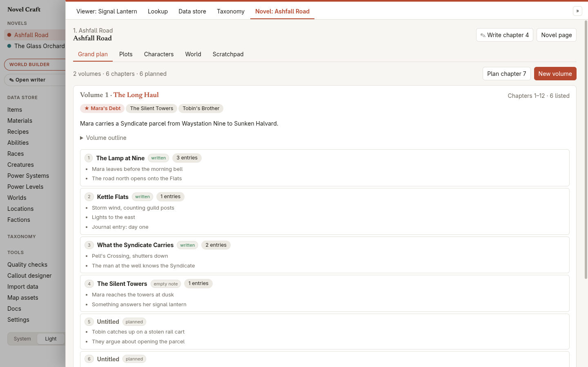

Each novel keeps its characters in its `Characters/` folder, one note (a sheet) per character.

## Creating a character

- On the novel page, press **New character**, or in the side drawer's Novel tab, **Characters → + New character**.
- Give the note a name (it must be unique in the vault) and fill in the fields. Field order and defaults come from the data store schema.

## The page

A character's page has its fields and sections like [any note](docs:notes-and-blocks), with **Save changes** (<kbd>Ctrl</kbd>+<kbd>S</kbd>). Personality and Appearance are sections, with the small appearance fields (gender, height, weight, eye and hair colour…) in two columns under Appearance.

The column beside it starts with a **chapter slider**. Below it, at that chapter: the character's stats, their first three relations and the first three things they carry, each with a link to the full list. The slider also sets the chapter of three tabs:

| Tab | Shows |
| --- | --- |
| Relations | Friendly, neutral and hostile, each person with their latest note, the chapter it is from, and how many earlier notes there were (and the standing before) |
| Inventory | Everything held at the chapter, by where it's kept, with condition, rarity and modifiers |
| Ledger | The [ledgers](docs:ledgers): stats panel, entries (later ones faded), comparing two chapters |

**+ Relationship entry**, **+ Inventory entry** and the Ledger tab's **New entry** open the entry editor as a tab of its own; saving or **×** goes back.

`relations/friendly`, `relations/neutral` and `relations/hostile` come from the character's [Relationships ledger](docs:ledgers#relationships); they are on the **Links & more** tab with the other fields the ledgers write.

Below the fields, the body's `## Bio`, `### Appearance` and other sections are [blocks](docs:notes-and-blocks) you can edit, move and add to.

Fields the ledgers manage (inventory, stat values) are read-only on the sheet: they come from the [ledgers](docs:ledgers) and are written back when entries are saved. **Sync sheets** on the novel page refreshes every sheet at once.

