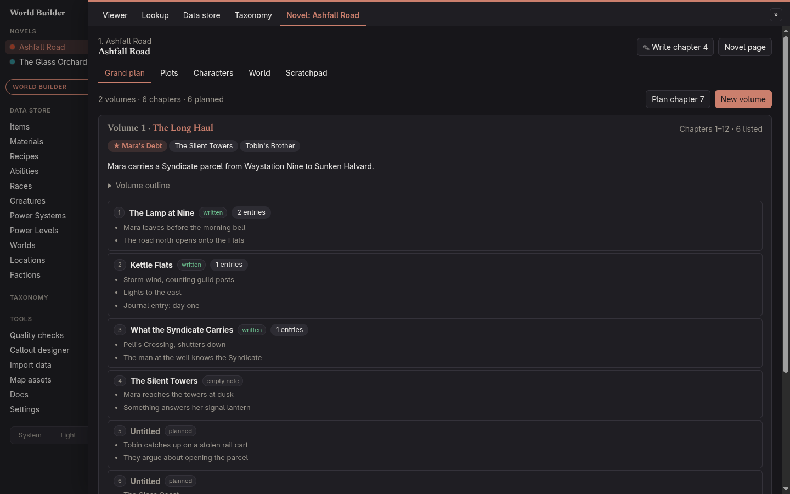

Each novel keeps its characters in its `Characters/` folder, one note (a sheet) per character.

## Creating a character

- On the novel page, press **New character**, or in the side drawer's Novel tab, **Characters → + New character**.
- Give the note a name (it must be unique in the vault) and fill in the fields. Field order and defaults come from the data store schema.

## The sheet

A character's note page shows its fields, editable in place, with **Save changes** (<kbd>Ctrl</kbd>+<kbd>S</kbd>). Fields named `relations/…` (`relations/ally`, `relations/rival`…) pick from the novel's characters and the factions.

Below the fields, the body's `## Bio`, `### Appearance` and other sections are [blocks](docs:notes-and-blocks) you can edit, move and add to.

Fields the ledgers manage (inventory, stat values) are read-only on the sheet: they come from the [ledgers](docs:ledgers) and are written back when entries are saved. **Sync sheets** on the novel page refreshes every sheet at once.

