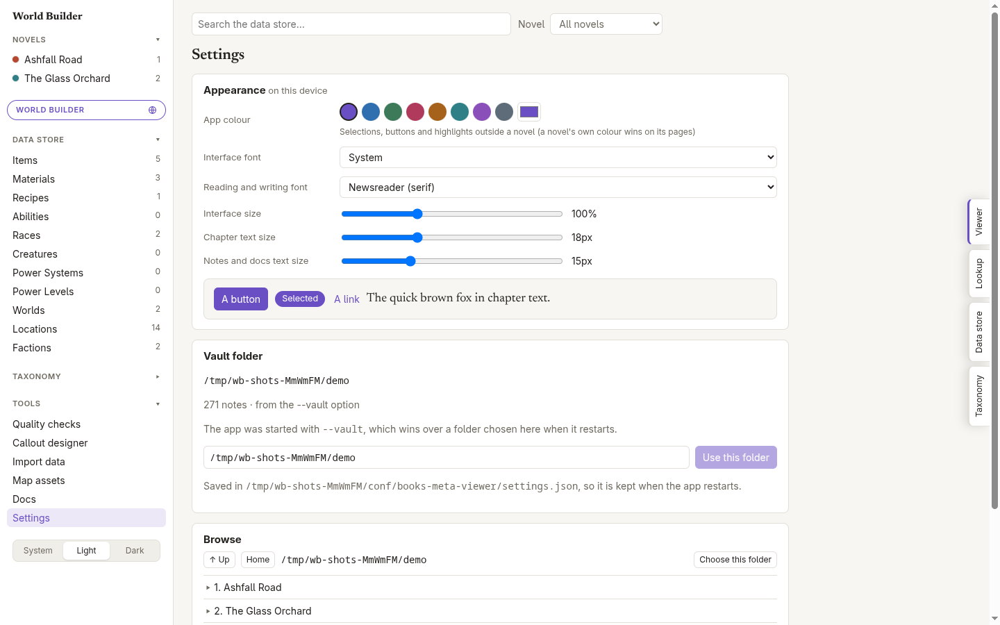

The vault is the folder Obsidian opens: the one that holds your notes and a hidden `.obsidian` folder. World Builder works on that folder directly.

## Choosing it

1. Open [Settings](app:#/settings) (sidebar → Tools). On the very first start the app shows only this page.
2. Type the vault's path into **Vault folder**, or use **Browse** below it. Folders Obsidian has opened are marked **vault**.
3. Press **Use this folder**. The app opens it straight away and remembers it for next time.



The choice is saved for this device only, in `~/.config/books-meta-viewer/settings.json`. Starting the app with `--vault <folder>` overrides it for that run.

## A new or empty vault

A vault without a data store schema can still be opened, but most pages need one. [Import the starter data](docs:importing-data) to add the schema, ledger types and a basic taxonomy.

## Trying it first

Make a demo vault with two invented novels (*Ashfall Road* and *The Glass Orchard*, the ones in these screenshots) and choose it on the Settings page:

```
npm run demo -- ~/World-Builder-Demo
```

> [!note] The app never touches `.obsidian/` or `.git/`. Deleted notes go to the vault's `.trash/` folder, the same as Obsidian's own trash.
