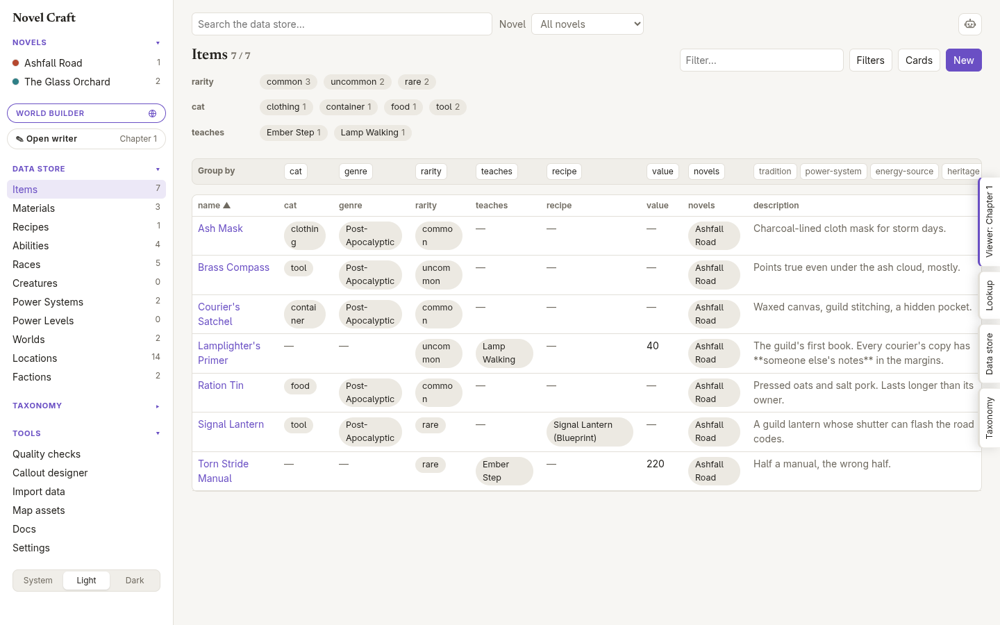
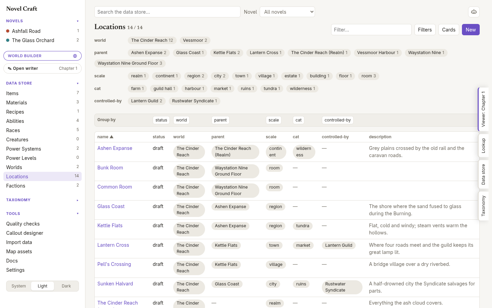
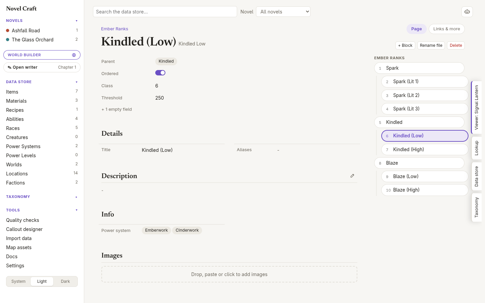

The data store holds the notes every novel shares: items, materials, recipes, abilities, races, creatures, power systems, worlds, locations, factions, and the taxonomy that categorises them. Each collection is a flat folder under `80. Global Data Store/`.

Open a collection from the sidebar's **Data store** section.

## Finding notes

- The filter box searches names, titles and descriptions.
- Facet chips filter by category values; values that would leave nothing are greyed out. Values in one facet are combined with "or", different facets with "and".
- **Filters** chooses which facet groups show.
- The **Novel** filter at the top limits notes to one novel.

## Grouping and columns

- **Group by** above a column splits the table into one table per value; a note with several values shows in each. Click again to ungroup; click a group's title to fold it.
- Drag a column header's edge to resize it (double-click resets); hold a header to collapse the column.

Your choices are remembered per collection.

## Opening notes

Clicking a note in a table opens it in the [side drawer](docs:side-drawer), so the table stays where it was. <kbd>Ctrl</kbd>+click opens the full page. **New** creates a note in the collection with the schema's fields.

## Taxonomies

A taxonomy is a set of category values, one note per value in `80. Global Data Store/Taxonomy/<Facet>/`: rarities, item categories, location scales. Categories on other notes are links to these values. Some taxonomies are ranked (`ordered`, with a `class` number per value) and values can have a `parent` for a hierarchy.

- **+ New taxonomy** at the bottom of the sidebar's Taxonomy section makes a new one: its entry in the data store schema and its folder. Paste values to make them at once, in rank order.
- **Add several…** on a taxonomy's page adds values from a list; **New** adds one.
- **Delete…** on a taxonomy's page deletes the whole taxonomy: its values move to the vault's `.trash`, after showing which notes link to them. Taxonomies the app or a field needs (Rarity, Genres…) are required and can't be deleted, nor can one a stat template uses; single values can, on their own pages.
- A list line `Name (A, B, C)` or `Name (Layer 1 - 9)` makes a value with sub-levels; indented lines are sub-levels of the line above; `= 100` at the end gives a value its number.
- Ticking **levels with a number each** gives every value a `threshold` and a `power-system`: levels of a power system that a [stat template](docs:stat-templates#choices) can work out from a stat. The levels can belong to several power systems. See [Levels and mastery systems](docs:levels-and-mastery).
- A value's page lists every value of a ranked taxonomy in the column beside it, in rank order.

