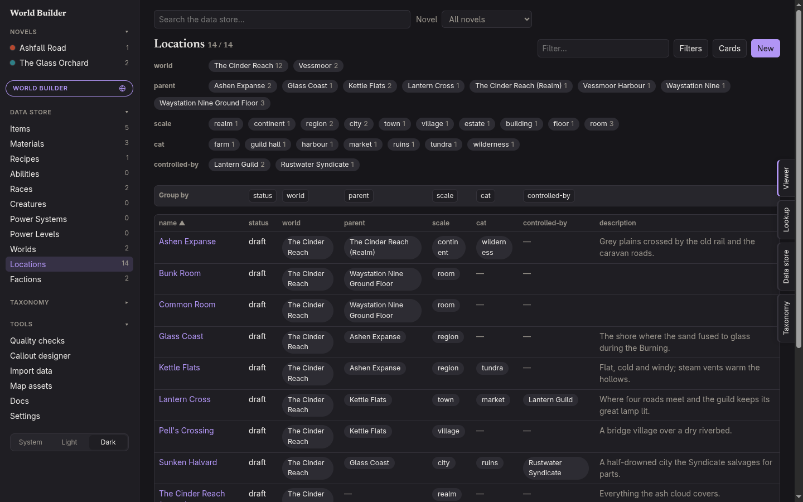

The data store holds the notes every novel shares: items, materials, recipes, abilities, races, creatures, power systems, worlds, locations, factions, and the taxonomy that categorises them. Each collection is a flat folder under `80. Global Data Store/`.

Open a collection from the sidebar's **Data store** section.

## Finding notes

- The filter box searches names, titles and descriptions.
- Facet chips filter by category values; values that would leave nothing are greyed out. Values in one facet are combined with "or", different facets with "and".
- **Filters** chooses which facet groups show.
- The **Novel** filter at the top limits notes to one novel.

## Grouping and columns

- **Group by** above a column splits the table into one table per value; a note with several values shows in each. Click again to ungroup; click a group's title to fold it.
- Drag a column header's edge to resize it (double-click resets); hold a header to collapse the column.

Your choices are remembered per collection.

## Opening notes

Clicking a note in a table opens it in the [side drawer](docs:side-drawer), so the table stays where it was. <kbd>Ctrl</kbd>+click opens the full page. **New** creates a note in the collection with the schema's fields.
