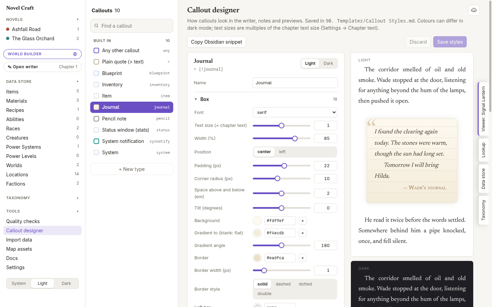

Callouts are the boxed blocks Obsidian writes as `> [!type] Title`. The callout designer sets how each type looks inside Novel Craft: in the writer, in notes and in previews.

Open [Callout designer](app:#/callout-design) (sidebar → Tools).

## Styles

The column on the left lists one style per callout type, each with a swatch of its colours: **Built in** (system, status, the stats panel's status window, sysnotify, inventory, item, blueprint, journal and pencil, plus **Any other callout** and **Plain quote**) and **Your types**. The box at the top finds a callout by name or type word.

The built-in looks are modern cards (system, notification, inventory, item, blueprint, and the status window), each with its own accent colour and a small label over the title, plus a paper journal page and a pencil margin note. Every one has light and dark colours, so callouts read well in both themes.

- **+ New type** makes a style for another type, starting from the one selected.
- Settings are grouped into **Box**, **Title**, **Text**, **Text elements** and **Effects** (grid pattern, ruled lines, a big quote mark, paper shading); click a group's heading to fold it.
- **Text elements** has a tab for each kind of text: **Body text**, **H1** to **H6**, **Bullet list** and **Numbered list**. Every tab has the same controls: colour, size, weight, italic, case, alignment, indent, space before and after, line height and letter spacing; headings add an underline colour, lists the bullet or number style, its colour and the gap between items. **Headings and lists** under the sample text fills the preview with one of each. Sizes and strengths are sliders (with the number beside them to type an exact value), short choices are rows of buttons, on / off settings are switches, and colours are a swatch that opens the colour picker plus the hex value.
- **Light** / **Dark** at the top switches which colours you edit; a colour left as it is in dark mode uses the light one.
- **Advanced CSS** takes extra rules for effects the settings don't cover. `&` stands for the callout.

The preview shows the callout between two chapter paragraphs, in both modes at once. Edit the sample text to try your own content.

**Save styles** writes them to `90. Templater/Callout Styles.md`, only what differs from the defaults.

> [!note] Obsidian keeps using your vault's theme and CSS snippets; these styles apply inside Novel Craft.

## Text size

Callout text is sized from the **chapter text** size (Settings → Chapter text), wherever the callout shows: in the writer, on note pages, in the stats panel and in previews. A style's **Text size** is a multiple of it (1 = the same size as the chapter text, 0.9 a little smaller), so changing the chapter text size changes every callout with it.

## Callouts in Obsidian

**Copy Obsidian snippet** at the top copies these looks as an Obsidian CSS snippet: save it as `.obsidian/snippets/world-builder-callouts.css` in your vault and turn it on under Obsidian's **Settings → Appearance → CSS snippets**. It covers every built-in type and your own (not *Any other callout* or plain quotes, which would restyle every callout and quote in the vault), follows Obsidian's light and dark themes, and sizes text from Obsidian's editor text size. Copy it again after changing styles.

The same snippet with the built-in looks is `obsidian/world-builder-callouts.css` in Novel Craft's folder; `node scripts/obsidian-snippets.js --vault <vault> --out <file>` writes it with a vault's saved styles.

> [!note] The snippet replaces your vault theme's look for these callout types (system, inventory…) while it is on.
