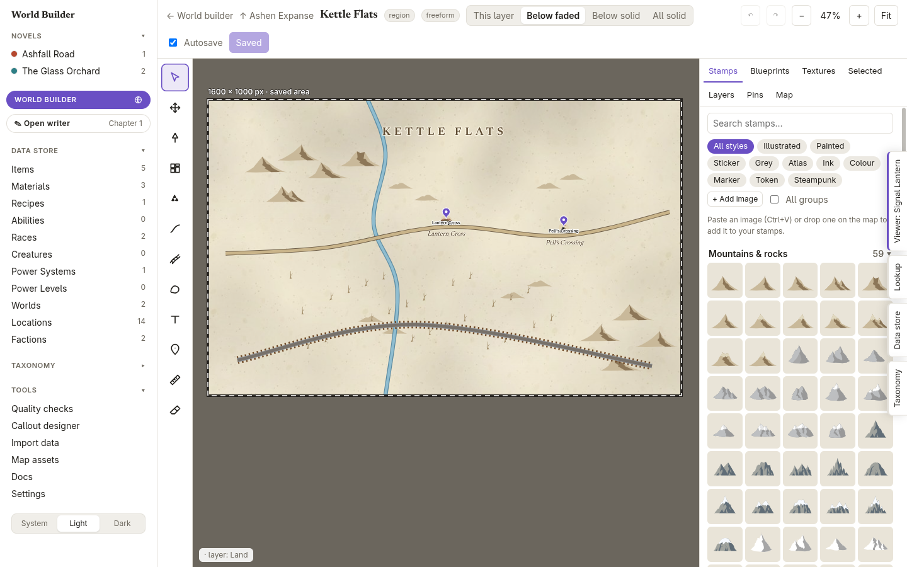
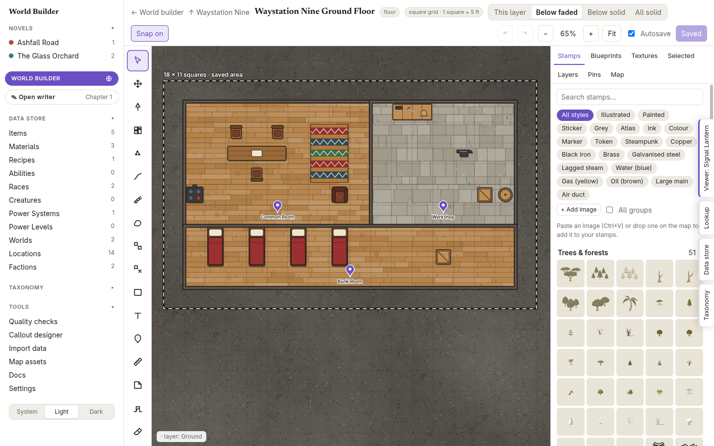

Every location can have one map, saved as an image Obsidian shows (`_Attachments/Maps/<Location> (Map).svg`) with everything needed to edit it inside.

## Two kinds of map

- **Freeform**: regions, coastlines, roads, mountains. Stamps go anywhere, lines curve.
- **Square grid**: floor plans and battle maps. One square is a set distance (5 ft by default); things snap to the grid.

## The tools

The toolbar on the left holds the tools; the full list with keys is in [Map editor tools and keys](ref:map-editor-reference). The ones you'll use first:

- **Stamp** (<kbd>I</kbd>): pick from about 700 built-in stamps or your own; <kbd>Q</kbd> / <kbd>E</kbd> rotate, <kbd>Z</kbd> / <kbd>X</kbd> scale before placing. Right-click goes back to Select.
- **Line** (<kbd>L</kbd>): roads, rivers, borders, walls. Double-click a line to add a point.
- **Room** (<kbd>R</kbd>): a room with its own floor, walls and grid. Things placed inside belong to it and move with it.
- **Floor** (<kbd>F</kbd>): paint squares with a texture.
- **Text** (<kbd>T</kbd>) and **Pin** (<kbd>P</kbd>): labels, and pins linking sub-locations (open the Pins panel to place them).

## Rooms, doors and walls

Rooms join when you drag them edge to edge, and joined rooms move together. **Add/cut** (<kbd>U</kbd>) changes a room's shape with boxes, circles or polygons; **Opening** (<kbd>N</kbd>) puts a door, window or gap in a wall.

## Layers and floors

The **Layers** panel holds layers such as floors of a building; layers below the one you edit show faded, solid or hidden (the buttons at the top). Hidden layers stay saved.

## Saving

Maps save automatically (**Autosave**) or with <kbd>Ctrl</kbd>+<kbd>S</kbd>. Stamps you used are embedded in the image, so the map shows in Obsidian and on other computers. Stamps and textures are tracked by their content: see [Map assets](docs:map-assets).

