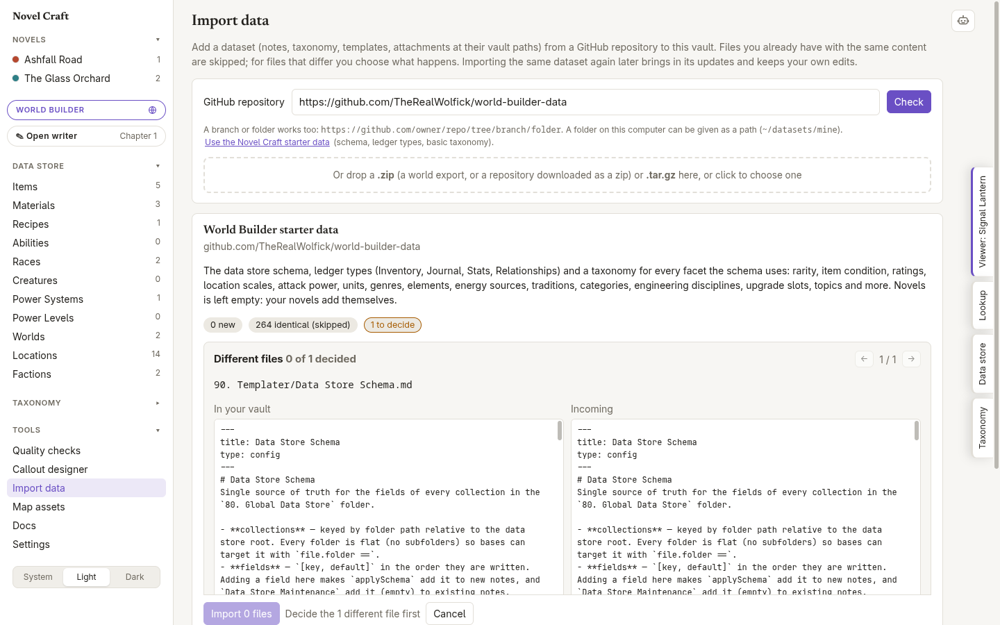

A dataset is a set of notes, taxonomy, templates and attachments laid out at their vault paths, usually shared as a GitHub repository. A new vault starts empty: importing the [Novel Craft starter data](https://github.com/TheRealWolfick/world-builder-data) gives it the data store schema, ledger types and a basic taxonomy.

## Checking a dataset

1. Open [Import data](app:#/import) (sidebar → Tools).
2. Paste the repository's URL, or press **Use the Novel Craft starter data**. A branch or sub folder works too: `https://github.com/owner/repo/tree/branch/folder`.
3. Press **Check**. The app downloads the repository and compares every file with your vault. Nothing is written yet.

The counts at the top say what the import will do. Every status is described in [Import data reference](ref:import-reference#how-files-are-compared).

## Deciding conflicts

A file that exists in both places with different content is shown side by side: your vault's version on the left, the incoming one on the right, with the changed lines marked.

- **Overwrite** takes the incoming file, **Skip** keeps yours.
- **Overwrite all remaining** and **Skip all remaining** decide every file not decided yet.

Blank fields count as the same however they are written, and so do created dates: two notes that differ only in those are skipped without asking.

## Names already used

Obsidian links notes by name, so a new note can't take a name another note already has.

- **Use mine** skips the incoming note; links to that name in the dataset now point at your note.
- **Import renamed** brings it in as `Name (Folder)` and changes the links in the imported notes to match.

Your choice is remembered: the next import from the same dataset applies it without asking.

## Importing again later

Every import is recorded in `90. Templater/Imports.md`. Checking the same dataset again then tells three cases apart:

- **Updated in the dataset**: you haven't changed the file since the last import, so the new version is written (untick any you want to keep as they are).
- **Changed by you**: you edited the file and the dataset didn't, so yours is kept.
- **To decide**: both changed. These come up as conflicts.

> [!tip] Renaming an imported note in the app keeps the record pointing at it, so later imports find it under its new name.
