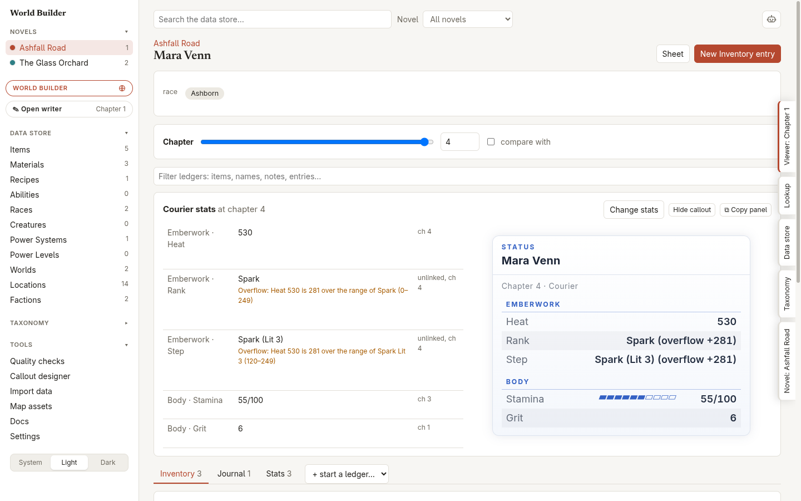
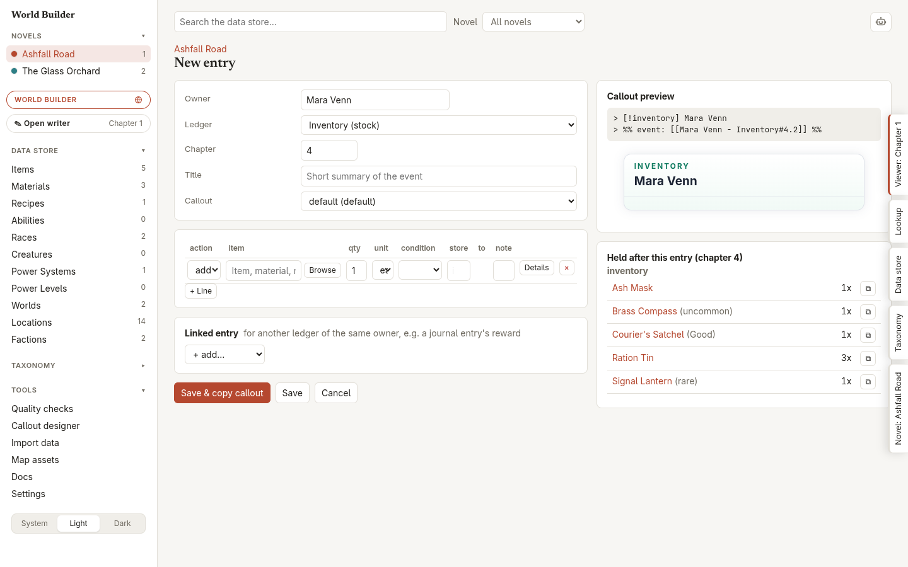

A ledger records what happens to one owner (a character, but also a ship, a train or a town) chapter by chapter. Each owner has one ledger note per type: `Ledgers/<Owner> - <Type>.md`.

| Type | Behaviour | Records |
| --- | --- | --- |
| Inventory | stock | Items and materials added, removed, moved between stores, given to others |
| Journal | log | Dated entries with text |
| Stats | state | Values set at a chapter (level, health, skills…) |
| Relationships | state | How the owner stands with others |

## An owner's ledgers

Click a character on the novel page's **Characters & ledgers** tab. The owner page shows every ledger, with what they hold or know at the chapter on the slider. Compare two chapters to see what changed. The filter box above the ledgers hides everything that doesn't match its words: entries, held items, changes, values, relationships and stats. A character opened in the side drawer has the same view on its **Ledger** tab, next to the **Character** tab with the sheet. New entries and edits started there open as a third tab beside them, so the sheet and the ledger stay a click away while you write; saving or closing the tab goes back to the Ledger.

## Writing an entry

**New entry** opens the entry editor: owner, ledger type, chapter, a short title, then one line per change.

- **Items** come from the data store; **Browse** opens the Items collection in the drawer to pick one, or type a name for a one-off item with no note.
- **Details** on a line sets condition, rarity and modifiers (an enchantment, an attachment).
- The **transfer-out** action, with a receiver, gives an item to another owner: their ledger gets the matching entry automatically.
- The preview shows the entry's callout and what the owner holds before and after.

Entries in the same chapter are numbered across all of a novel's ledgers, so they keep their order on the chapter page.

## Relationships

A Relationships entry has one line per character or faction (a sect, a clan): **with** whom, the **standing** (friendly, neutral or hostile) and a short **note** on why, or how things stand now. Later entries change only what changes: a new standing, a new note, or both (a standing changed without a note keeps the old note).

The character's sheet lists them in three sections, friendly, neutral and hostile, each with the name, the current note and the chapter it last changed; long sections show the first few and **Show all**. The frontmatter gets `relations/friendly`, `relations/neutral` and `relations/hostile` lists of links (for Bases); the notes stay in the ledger. To look back, move the chapter slider on the owner's **Relationships** tab: it shows where they stood at that chapter.

## Entries in the chapter text

Every entry can be copied as a callout (**Copy** / **Callout**) and pasted into the chapter. Pasted entries carry a hidden marker, so the chapter page shows which entries are **in chapter text** and which are **not in text yet**. How the callouts read is set by [callout templates](ref:callout-templates); how they look, by the [callout designer](docs:designing-callouts).
