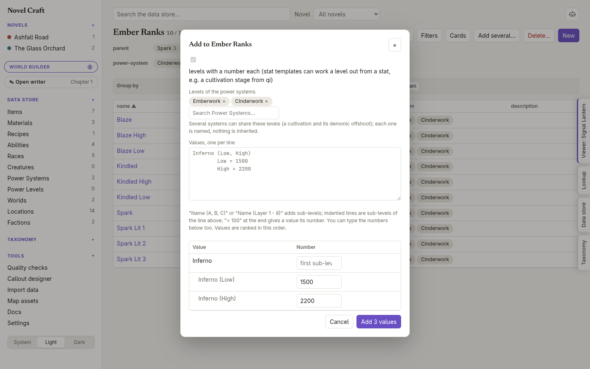
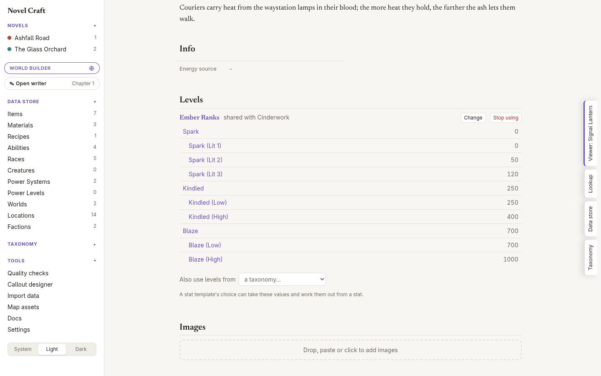
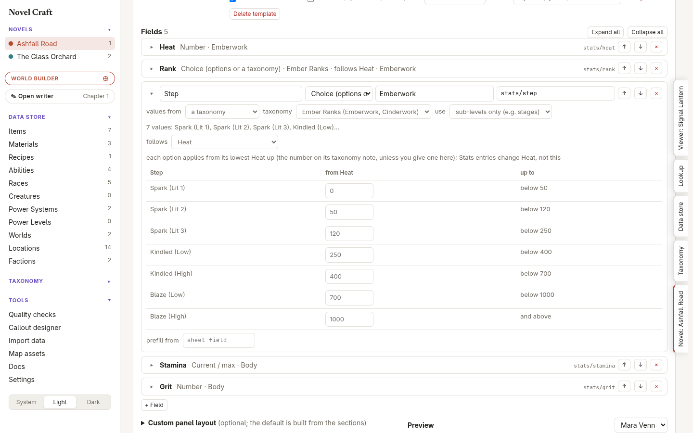
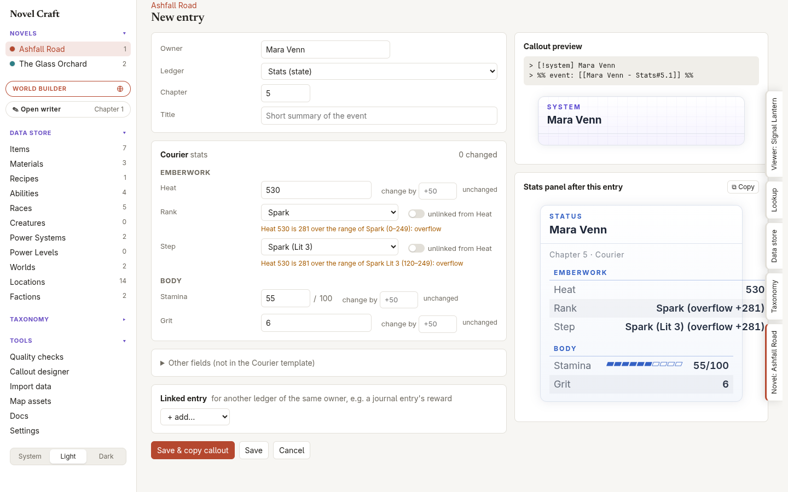

A level system is a ladder of named steps that a character climbs: cultivation realms and their stages, adventurer ranks, mastery of a sword art. In Novel Craft it has three parts:

1. **The levels** are values of a [taxonomy](docs:collections#taxonomies), each with a number: the lowest value of a stat that reaches it. They can belong to one or several power systems.
2. **A stat template** has a number field (qi, experience, mastery points) and a choice field that **follows** it: the level is worked out from the number.
3. **Stats entries** in the ledger change the number (a reward of `+50` qi), and the level follows, chapter by chapter.

The example below builds cultivation for a novel where Wade's realm and stage depend on his qi. The pictures show the same thing in the demo vault: the courier Mara Venn, whose Rank and Step in *Emberwork* follow her Heat.

## 1. Make the levels

In the sidebar, open **Taxonomy** and click **+ New taxonomy** at the bottom of the list.

- **Name**: *Cultivation Levels*.
- Tick **levels with a number each**, and choose the power systems they belong to under **Levels of the power systems** (*Cultivation*). This adds `threshold` and `power-system` to every value.
- Paste the levels, one per line, highest last:

```
Qi Refining (Layer 1 - 9)
Foundation Establishment (Early, Mid, Late, Peak)
Golden Core (Early, Mid, Late, Peak)
Nascent Soul (Early, Mid, Late, Peak)
```

The preview shows what will be made. A line with a list in brackets becomes a level with sub-levels: *Qi Refining* with *Layer 1* … *Layer 9*, *Foundation Establishment* with *Early*, *Mid*, *Late* and *Peak*. Sub-level notes are named after their parent (*Foundation Establishment Early*, shown as *Foundation Establishment (Early)*), because note names are unique across the vault. You can also put sub-levels on their own lines, indented under their level.

Type each level's **number** in the preview table, or write it on the line: `Golden Core = 5000`, or indented `Early = 5000`. A level without a number of its own starts where its first sub-level does, so usually only the sub-levels need numbers.



**Make taxonomy** adds *Cultivation Levels* to the data store schema, makes its folder and writes one note per value, ranked in the order of the list (`class`), with `parent`, `threshold` and `power-system`.

> [!tip] Adding or changing levels later
> **Add several…** on the taxonomy's page adds more values the same way; they rank after the existing ones. **New** adds a single value. Every value is an ordinary note: change its `threshold`, `class` or title on its page.

The power system's page (*Cultivation*) now lists its **Levels**, with sub-levels indented and their numbers.

### Sharing levels between power systems

*Demonic Cultivation* climbs the same ladder as *Cultivation*. On its page, under **Levels**, choose the taxonomy in **Use levels from**: every level now names both systems. Nothing is inherited from a parent system, so another offshoot can have levels of its own.

- **Change** swaps a system's taxonomy for another in one step.
- **Stop using** takes this system off the levels; the others keep them.
- Any taxonomy can be chosen. One made without numbers gets a `threshold` and a `power-system` when a system starts to use it.



## 2. Link it to the stat template

On the novel page's **Stats** tab, open the template (see [Stat templates](docs:stat-templates)):

1. Add a **Number** field, *Qi*: the stat that grows. Tick *whole numbers* if it has no fractions.
2. Add a **Choice** field, *Realm*. Under **values from** pick *a taxonomy*, then *Cultivation Levels (Cultivation)*. Since the levels have sub-levels, **use** offers *top levels only*: the four realms.
3. Set **follows** to *Qi*. The table below lists each realm, the qi it starts from (taken from the taxonomy notes, shown greyed) and where it ends. Type a number in a row only to use a different one in this template.
4. Add another **Choice** field, *Stage*, from the same taxonomy, using *sub-levels only*, also following *Qi*.



Save the template. Realm and Stage are now worked out from Qi at every chapter, and the sheet shows them read-only. You can still set a level through the ledger (below): that moves Qi to match.

A choice from a taxonomy can also be one you set yourself: leave **follows** at *nothing*, and Stats entries pick the value from the list.

## 3. Change it through the ledger

Open the character's ledger and start a **Stats** entry (or **Change stats** on their stats panel). From the side drawer, open the character, go to the **Ledger** tab and press **New … entry** (or **Edit** on an entry): the entry opens as a third tab beside **Character** and **Ledger**, and stays there while you look at the other two. Saving or closing it (×) goes back to the Ledger tab. The form shows every field at its value before the entry.

- Type a new value in *Qi* to set it outright, or use its **change by** box for a reward or a cost: `+50`, `-20`. A change is written as `[set:: stats/qi] [add:: 50]` and adds to whatever qi was at that point, so editing an earlier entry carries through to later ones.
- Or pick a **level** directly: choosing *Golden Core (Early)* for Stage writes `[set:: stats/stage] [value:: [[Golden Core Early]]]`, and Qi moves to that level's lowest value (5000), unless Qi is already inside the level's range, in which case it stays. Use this for a breakthrough.
- Realm and Stage update in the form as you type, with what they were before.

### Overflow, special constitutions and deficiencies

Sometimes a character's number and level part ways: Wade has stored qi far beyond his stage, a special constitution holds more qi than the realm allows, a mage has far less mana than others at her mastery. Each level that follows a number has a **link switch** beside it in the Stats form:

- **Switch it off** (unlinked) and the level keeps the value it has, or the one you pick, while the number moves on its own. The entry writes `[link:: off]` on the level's line, so the ledger records the chapter where it happened.
- While a level is unlinked and its number is outside the level's range, the form, the stats panel and the sheet show an **overflow** (how far above) or **underflow** (how far below), for example *Overflow: Qi 1500 is 301 over the range of Foundation Establishment (Early) (1000–1199)*. The status window panel adds it after the level.
- **Switch it back on** (`[link:: on]`) when the character settles, and the level is worked out from the number again.

Setting a level while it is unlinked changes only the level.



Saved, the entry's callout reads like `- stats/qi: +50` (or `- stats/stage: Golden Core Early (unlinked)`), the character sheet gets the new qi, realm and stage, and the stats panel on the owner page shows them at any chapter: move the **chapter** slider to see when Wade reached Foundation Establishment.

The [assistant](docs:ai-assistant) writes the same lines: `{set: "qi", add: 50}` for a reward, `{set: "stage", value: "Golden Core Early"}` for a breakthrough, `{set: "stage", link: "off"}` to unlink. It can also propose the levels themselves: a new taxonomy with its values, more values, and which power systems use them.

## Mastery and other ladders

The same steps make any ladder. For a weapon art: a taxonomy *Sword Mastery* with *Novice = 0*, *Adept = 100*, *Expert = 400*, *Master = 1000* (levels of the power system, or none), a number field *Mastery points* and a choice *Mastery* that follows it. Templates can hold several, each with its own number.

Ladders without numbers work too: leave **levels with a number each** off, and the values are a ranked list a choice can pick from.
