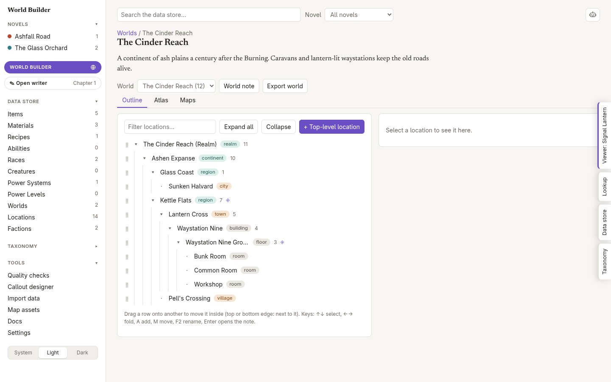
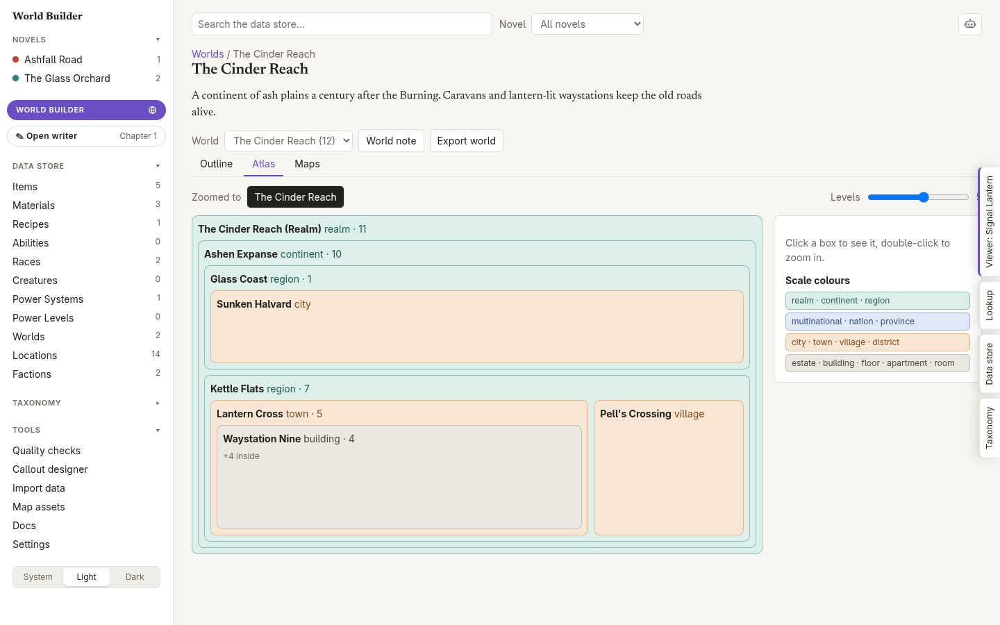

Open the **World builder** pill in the sidebar. Each world has three tabs: Outline, Atlas and Maps.

## The outline

Places are a tree: a realm holds continents, a continent regions, down to towns, buildings, floors and rooms. The tree comes from each location's `parent` field; siblings sort by scale, then name.

- **+** on a row adds a place inside it, one scale smaller by default. A place can't be inside one of the same or a larger scale.
- Drag a row onto another to move it inside; drop on the top or bottom edge to put it next to it. **Move** opens a dialog with search, for long moves.
- **Rename** (<kbd>F2</kbd>) changes the title and file name together; links follow.
- **Map** opens or creates the place's map.
- Keys: <kbd>↑</kbd> <kbd>↓</kbd> select, <kbd>←</kbd> <kbd>→</kbd> fold, <kbd>A</kbd> add, <kbd>M</kbd> move, <kbd>Enter</kbd> opens the note.

Moves can be undone from the message that appears.

## The atlas

Nested boxes sized by how much each place holds, coloured by scale. Click to select, double-click to zoom in.

## Sharing

**Export world** packs the world for others: see [Exporting and importing worlds](docs:sharing-worlds).
