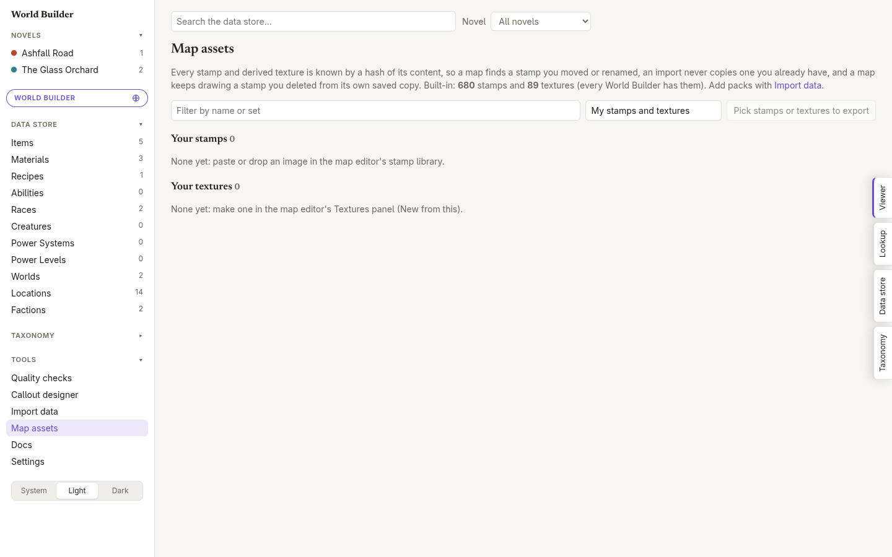

Map assets are the stamps and textures maps are drawn with. The built-in set (about 700 stamps and 90 textures) comes with the app. Your own stamps (images you paste or drop into the stamp library) live in `_Attachments/Map Stamps/`, and derived textures in `90. Templater/Map Textures.md`.

Open [Map assets](app:#/map-assets) (sidebar → Tools).

## Known by their content

Every stamp and texture has a hash of its content, and maps record the hashes of what they use. So:

- a map still finds a stamp you moved or renamed;
- importing a world never copies a stamp you already have, whatever it is called;
- a map keeps drawing a stamp you deleted, from the copy saved inside it.

## Deleting

**Delete** on a stamp moves its file to the vault's `.trash`; on a texture, it removes the definition. The page shows how many maps use each one first. Maps that use a deleted one keep their own copy.

## Sharing as a pack

Tick stamps and textures, name the pack, and press **Export as a pack**: a `.zip` others import on the [Import data](app:#/import) page, the same way as a world.
