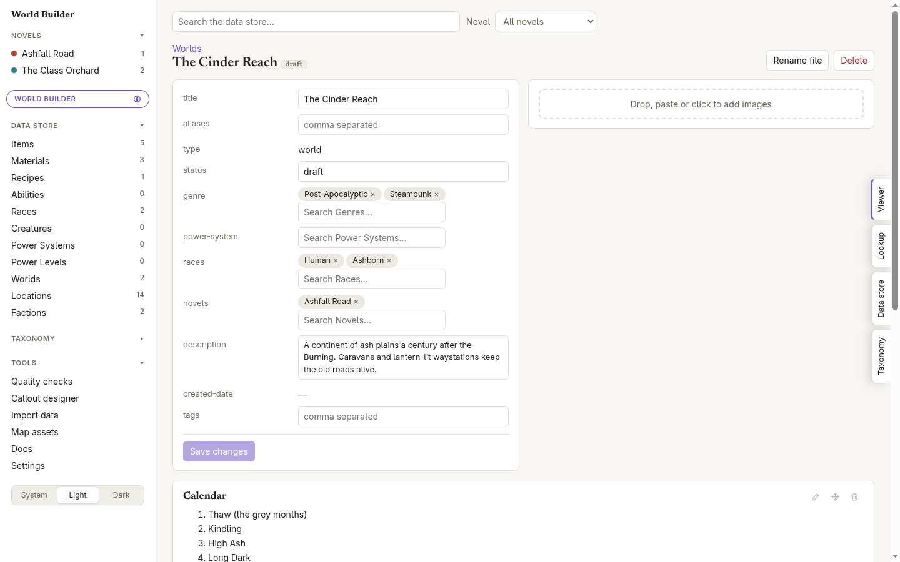

Every note page has its frontmatter fields on one side and its content on the other: a summary, what links to it, images, and its blocks.

## Fields

Fields are always editable. Link fields pick from the right collection (a location's `parent` from Locations, a category from its taxonomy), lists take several values, and changed fields are marked until you press **Save changes** (<kbd>Ctrl</kbd>+<kbd>S</kbd>). Only the fields you changed are written; everything else in the note stays as it was.

## Blocks

The note's body is split into blocks at its `## Heading`s, for example a world's **Calendar** or **Currency**. Each block has three icons:

- **Pencil**: edit the block's title and text, with the writer's formatting tools. **Save** or <kbd>Ctrl</kbd>+<kbd>S</kbd>.
- **Arrows**: move mode. <kbd>↑</kbd> <kbd>↓</kbd> move the block, <kbd>Enter</kbd> or <kbd>Escape</kbd> saves the order.
- **Bin**: delete, after a second click.

**+ Add block** asks for a title and suggests the ones other notes of the collection use, so every world can have the same set of blocks. The text before the first heading is a block of its own.

Saving rewrites only the block you changed; the rest of the note keeps its exact text. Recipe notes keep their plain body, because the crafting scripts read it.

## Images, renaming and deleting

Drop, paste or click to add images; they are stored in `_Attachments/<Collection>/` and listed in the note's `images`. **Rename file** and **Delete** are covered in [Renaming and deleting](docs:renaming-and-deleting).
