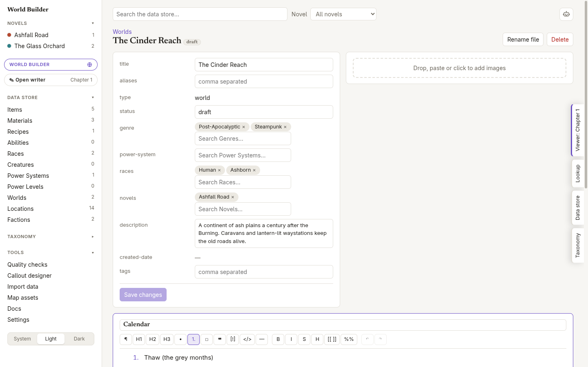

Every note opens as a page you read like a document: its title and tabs on top, the note in the middle, and a narrow column beside it with what it relates to (who holds an item, a plot's main plot and subplots, a character's stats, relations and inventory). The same page shows in the side drawer and in a [left-drawer tab](docs:side-drawer#tabs-on-the-left); in a narrow space the column moves above the page.

| Tab | Holds |
| --- | --- |
| Page | The fields, the long text fields as sections, the note's blocks and images |
| Relations, Inventory, Ledger | A novel's characters only: see [characters](docs:characters#the-page) |
| Links & more | Notes that link here and that this note links to, and technical fields (file, type, created date, fields the ledgers write) |

## Fields

Short fields are a list of properties under the title. Click one to edit it; it closes again when you click elsewhere. Empty ones fold into **+ N empty fields**. Link fields pick from the right collection (a location's `parent` from Locations, a category from its taxonomy), lists take several values.

Long text fields (a description, a character's personality and appearance, a plot's text) are sections of the page instead: they always show, with a **-** when they're blank. The pencil or a double-click edits one; **Done** closes it. Which fields are sections comes from the collection's `summary.sections` in the [schema](docs:vault-conventions), and any field holding a long text becomes one too. Small fields can sit under a section as a two-column list: a character's eye colour, hair and height under **Appearance**, for example. A collection's `groups` in the schema sets these (`"groups": {"appearance": ["eye-color", "hair-color", "height"]}`). A character's page starts with a **Bio** section of this kind (race, alive, age, member of, wealth, power system, talent), and its skills are a section of their own, shown as a list.

Some fields never show on the page, only on **Links & more**: `cssclasses`, and for characters fields that are left over or covered elsewhere (chapter introduced and updated, level and sub-level, which stat templates replace, and the inventory and items lists, which the ledgers keep). A collection's `hidden` list in the schema sets them.

Changed fields are marked until you press **Save changes** (<kbd>Ctrl</kbd>+<kbd>S</kbd>), which appears once something has changed. Only the fields you changed are written; everything else in the note stays as it was.

## Blocks

The note's body is split into blocks at its `## Heading`s, for example a world's **Calendar** or **Currency**. Each block has three icons:

- **Pencil**: edit the block's title and text, with the writer's formatting tools. **Save** or <kbd>Ctrl</kbd>+<kbd>S</kbd>.
- **Arrows**: move mode. <kbd>↑</kbd> <kbd>↓</kbd> move the block, <kbd>Enter</kbd> or <kbd>Escape</kbd> saves the order.
- **Bin**: delete, after a second click.

**+ Add block** asks for a title and suggests the ones other notes of the collection use, so every world can have the same set of blocks. The text before the first heading is a block of its own.

Saving rewrites only the block you changed; the rest of the note keeps its exact text. Recipe notes keep their plain body, because the crafting scripts read it.

## Images, renaming and deleting

Drop, paste or click to add images; they are stored in `_Attachments/<Collection>/` and listed in the note's `images`. **Rename file** and **Delete** are covered in [Renaming and deleting](docs:renaming-and-deleting).
