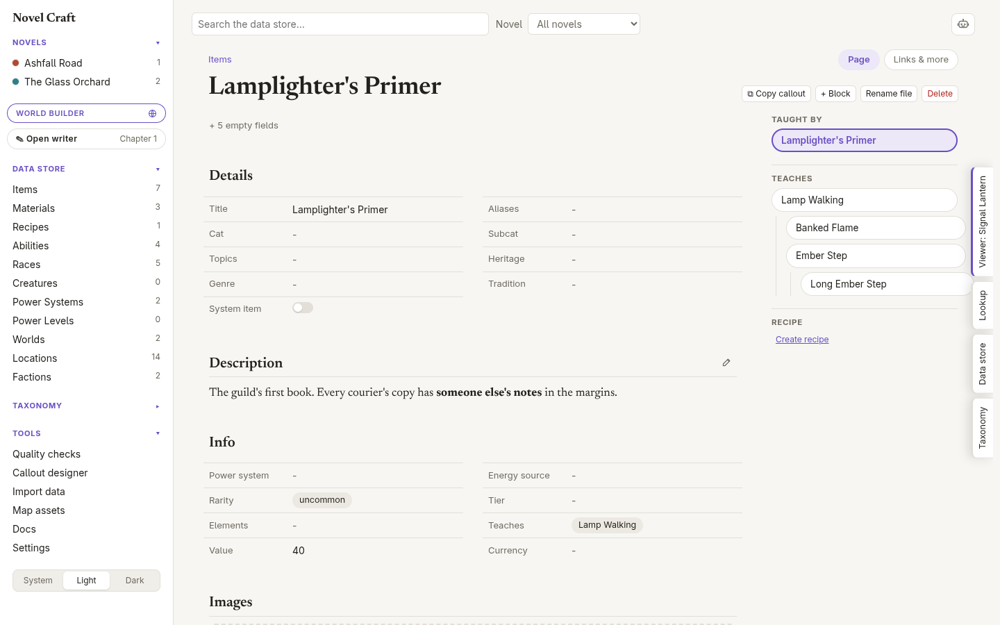
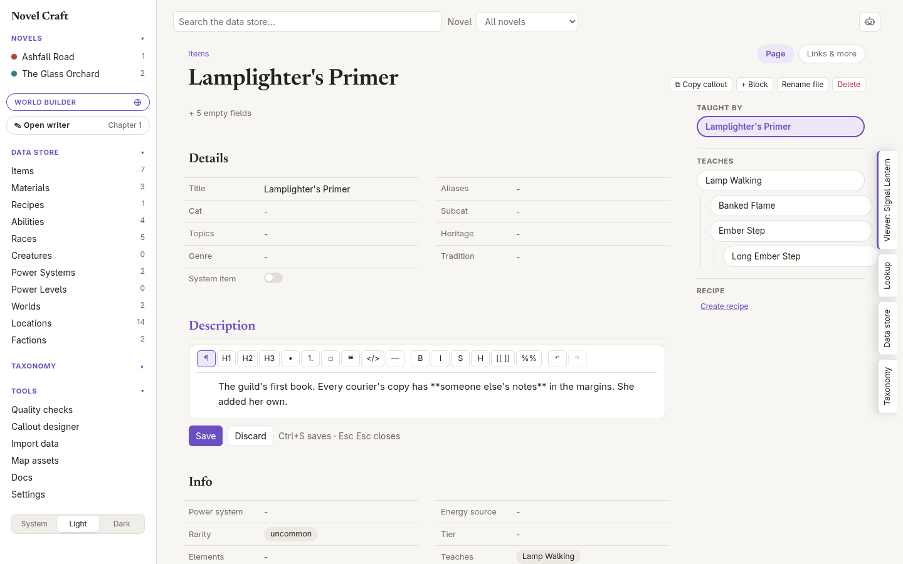
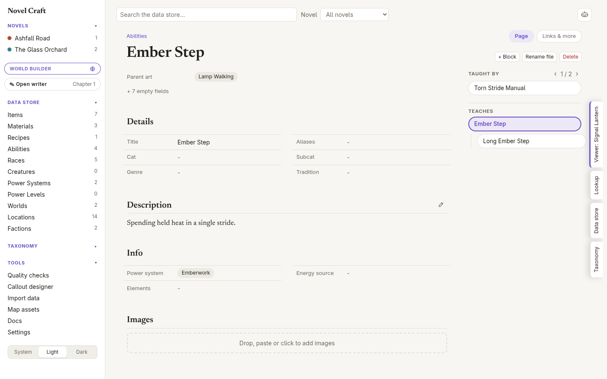
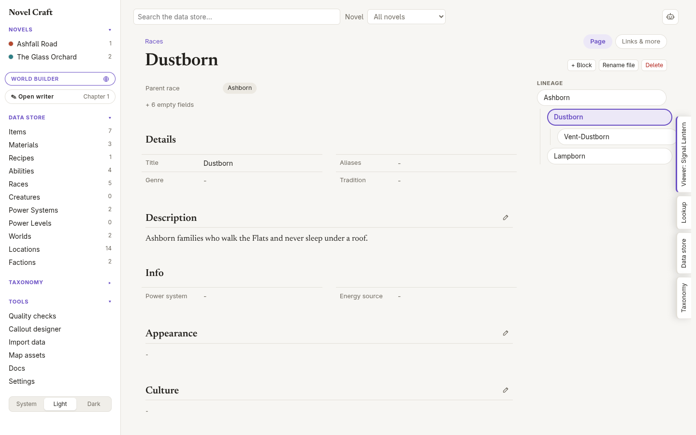

Every note opens as a page you read like a document: its title and tabs on top, the note in the middle, and a narrow column beside it with what it relates to (who holds an item, what teaches an ability, a race's lineage, a plot's family, a character's stats, relations and inventory). The same page shows in the side drawer and in a [left-drawer tab](docs:side-drawer#tabs-on-the-left); in a narrow space the column moves above the page.

| Tab | Holds |
| --- | --- |
| Page | The fields, the long text fields as sections, the note's blocks and images |
| Relations, Inventory, Ledger | A novel's characters only: see [characters](docs:characters#the-page) |
| Links & more | Notes that link here and that this note links to, and technical fields (file, type, created date, fields the ledgers write) |

## Sections

Data store and taxonomy notes group their fields under headings, whatever the collection (fields it doesn't have are left out):

| Section | Fields |
| --- | --- |
| Details | Title, aliases, category, subcategory, topics, heritage, genre, tradition, system item |
| Description | The description |
| Info | Power system, energy source, rarity, tier, elements, teaches, value, currency |

Other fields stay in the list at the top. An item with a recipe also has a **Build tree** section ([recipes](docs:recipes)), and a power system a **Levels** section ([levels](docs:levels-and-mastery)).

## Fields

Short fields are a list of properties under the title. Click one to edit it; it closes again when you click elsewhere. Empty ones fold into **+ N empty fields**. Link fields pick from the right collection (a location's `parent` from Locations, a category from its taxonomy), lists take several values, and yes/no fields are switches.

Long text fields (a description, a character's personality and appearance, a plot's text) are sections of the page instead: they always show, formatted, with a **-** when they're blank. The pencil or a double-click edits one in the same editor as the [writer](docs:writing-a-chapter): pasted paragraphs become paragraphs, and bold, italics and links are kept (as markdown text in the frontmatter). **Save** and **Discard** sit under the section. <kbd>Ctrl</kbd>+<kbd>S</kbd> saves and closes it (or just closes it when nothing changed); <kbd>Escape</kbd> twice closes it too, the first press selecting the block.

Which fields are sections comes from the collection's `summary.sections` in the [schema](docs:vault-conventions), and any field holding a long text becomes one too. Small fields can sit under a section as a two-column list: a character's eye colour, hair and height under **Appearance**, for example. A collection's `groups` in the schema sets these (`"groups": {"appearance": ["eye-color", "hair-color", "height"]}`). A character's page starts with a **Bio** section of this kind (name, aliases, race, alive, age, member of, wealth, power system, talent), and its skills are a section of their own, shown as a list.

Some fields never show on the page, only on **Links & more**: `cssclasses`, novels, unit and recipe on data store notes, and for characters fields that are filled in for you or covered elsewhere (the novel, chapter introduced and updated, level and sub-level, which stat templates replace, and the inventory and items lists, which the ledgers keep). A collection's `hidden` list in the schema sets them.

Changed properties are marked until you press **Save changes** (<kbd>Ctrl</kbd>+<kbd>S</kbd>), which appears at the bottom once something has changed. Only the fields you changed are written; everything else in the note stays as it was.

## Blocks

The note's body is split into blocks at its `## Heading`s, for example a world's **Calendar** or **Currency**. A block looks like any other section of the page; it has three icons:

- **Pencil**: edit the block's title and text, with the writer's formatting tools. **Save** or <kbd>Ctrl</kbd>+<kbd>S</kbd>; <kbd>Escape</kbd> twice closes it when nothing changed.
- **Arrows**: move mode. <kbd>↑</kbd> <kbd>↓</kbd> move the block, <kbd>Enter</kbd> or <kbd>Escape</kbd> saves the order.
- **Bin**: delete, after a second click.

**+ Block** in the note's header asks for a title and adds a block at the end. The text before the first heading is a block of its own.

Saving rewrites only the block you changed; the rest of the note keeps its exact text. Recipe notes keep their plain body, because the crafting scripts read it.

## The column

The narrow column links related notes. Click one to go there: the column stays where it is, and so does your place on the page, so you can step through a family.

| Note | Column |
| --- | --- |
| Something that **teaches** (an item, a manual) | What it teaches, with each ability's sub-arts under it |
| An ability | **Taught by**: what teaches it or one of its parent arts; with several, ‹ › steps through them and the tree follows |
| A race | **Lineage**: the races above and below it, through `parent-race` |
| A value of a ranked taxonomy | Every value in rank order, sub-values under their parent |
| A plot or volume | The volume, its main plot and its subplots ([planning](docs:planning#plot-ideas)) |
| An item or material | Who holds it, and where it is used |

A long column scrolls on its own: an arrow at its top or bottom shows there is more that way (click it to move). Long titles end with …; hover to read them.

## Images, renaming and deleting

Drop, paste or click to add images; they are stored in `_Attachments/<Collection>/` and listed in the note's `images`. **Rename file** and **Delete** are covered in [Renaming and deleting](docs:renaming-and-deleting).
