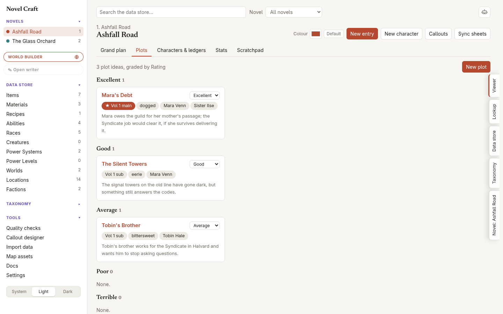

A novel's plan lives in three kinds of notes, all edited from the novel page:

| Note | Holds | Folder |
| --- | --- | --- |
| Volume | Title, number, main plot and subplots, chapter range, description, outline | `Plan/Book Plan/` |
| Chapter plan | The chapter's outline and working title | `Plan/Chapter Plans/` |
| Plot | A plot idea: grade, the plot it is a subplot of, characters, mood, text | `Plots/` |

## The grand plan

The novel page's **Grand plan** tab lists the volumes in order, each with its plots and its chapters. A chapter row shows whether it is written, planned or still an empty note, and the first lines of its plan.

- **New volume** starts after the last one; set its chapter range on its note.
- **Plan chapter N** opens the next chapter's plan.
- Clicking a chapter opens it in the side drawer: its plan, then its ledger entries.

## Writing a chapter plan

The plan is an outline: one event per line.

- <kbd>Enter</kbd> starts the next event at the same level.
- <kbd>Tab</kbd> / <kbd>Shift</kbd>+<kbd>Tab</kbd> makes it a sub event or moves it back out, with everything under it.
- <kbd>Alt</kbd>+<kbd>↑</kbd> / <kbd>↓</kbd> moves an event.

Until the chapter has a note, the plan's **Working title** is the chapter's title. Press **✎ Write** to start the chapter itself.

## Plot ideas

The **Plots** tab sorts plot notes by their grade (the Rating taxonomy). Change a grade with the select on its card; **New plot** adds one. A volume's main plot and subplots are links to these notes.

A plot can be a subplot of another: its **Subplot of** field names the main plot. A plot's page then shows the family in the column beside it: **Main plot**, then **Subplots**, with the plot you're on marked; click another to open it. A subplot's page names its main plot at the top. A main plot's page lists its subplots in a **Subplots** section, each with its text: the pencil or a double-click edits a subplot's text right there, and **Save** writes it to the subplot's own note. **+ Add a subplot** makes a new plot that is a subplot of this one.

Volumes use the same structure. A volume's page shows its **Main plot** (its Plot field) and **Subplots** in the column, and both again on the page with their text, edited in place like a plot's subplots. A volume's subplots are the plots its Subplots field lists plus every plot that is a subplot of its main plot, so a subplot shows in the volume however you linked it; the Grand plan's plot chips follow the same rule. **+ Add a subplot** on a volume makes a subplot of its main plot (or, with no main plot yet, adds the new plot to the volume's Subplots field).

