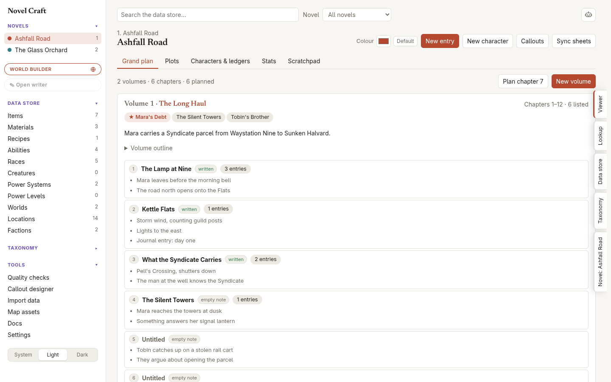
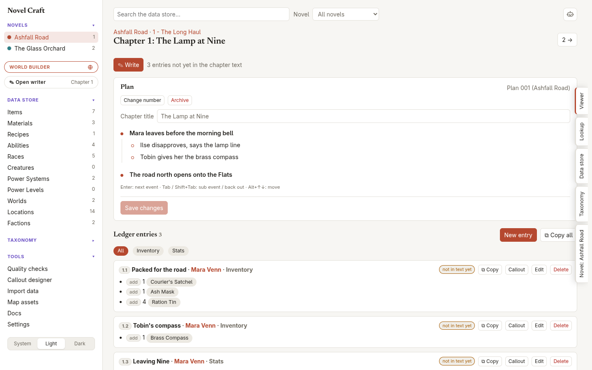
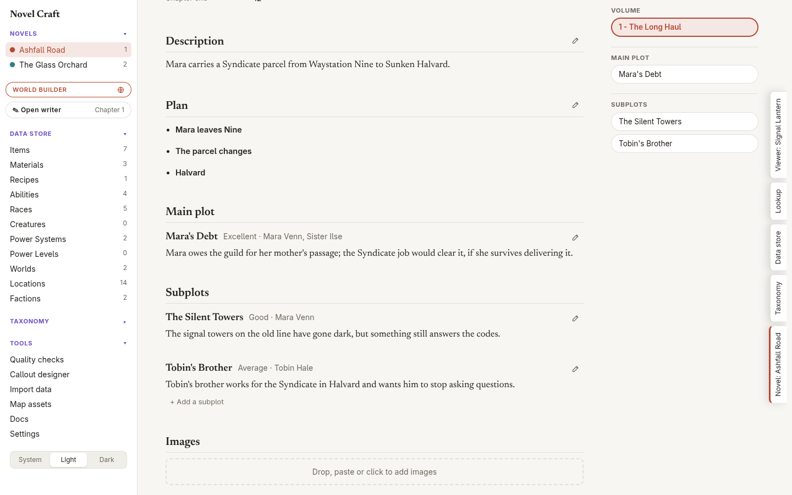
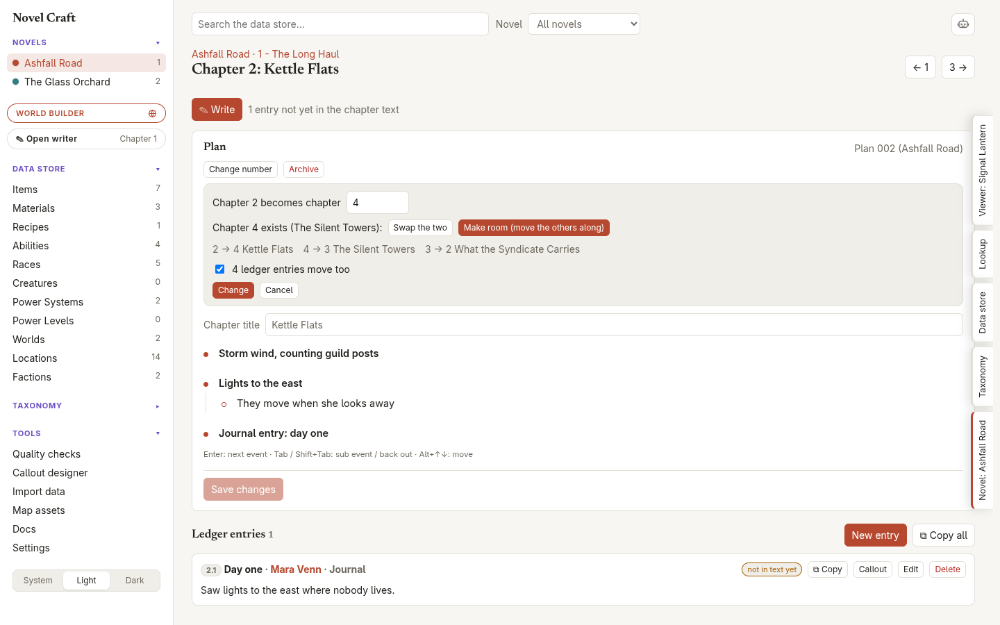
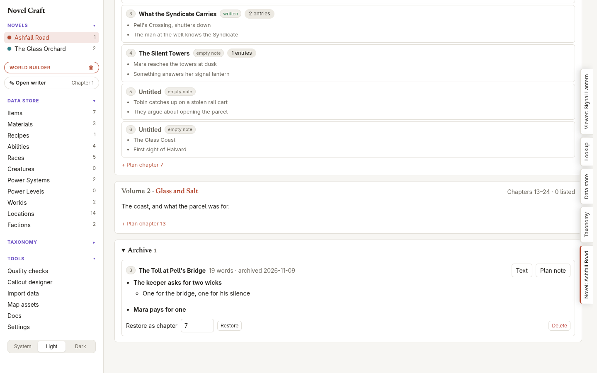

A novel's plan lives in three kinds of notes, all edited from the novel page:

| Note | Holds | Folder |
| --- | --- | --- |
| Volume | Title, number, main plot and subplots, chapter range, description, outline | `Plan/Book Plan/` |
| Chapter plan | The chapter's outline and title | `Plan/Chapter Plans/` |
| Plot | A plot idea: grade, the plot it is a subplot of, characters, mood, text | `Plots/` |

## The grand plan

The novel page's **Grand plan** tab lists the volumes in order, each with its plots and its chapters. A chapter row shows whether it is written, planned or still an empty note, and the first lines of its plan.

- **New volume** starts after the last one; set its chapter range on its note.
- **Plan chapter N** opens the next chapter's plan.
- Clicking a chapter opens it in the side drawer: its plan, then its ledger entries.
- The **archive** is at the bottom ([below](docs:planning#archive-a-chapter)).

## Writing a chapter plan

The plan is an outline: one event per line.

- <kbd>Enter</kbd> starts the next event at the same level.
- <kbd>Tab</kbd> / <kbd>Shift</kbd>+<kbd>Tab</kbd> makes it a sub event or moves it back out, with everything under it.
- <kbd>Alt</kbd>+<kbd>↑</kbd> / <kbd>↓</kbd> moves an event.

Every plan has a chapter note: saving a plan for a chapter that has none makes an empty one, and so does opening a plan made in Obsidian. An empty note counts as planned, not written. Press **✎ Write** to write it.

**Chapter title** on the plan is the chapter's title. Change it there, in the writer or on either note, and the other follows; the chapter's file name follows too when it was made from the title (`014 - Title.md`). Save the chapter in the writer before changing its title on the plan.

## Plot ideas

The **Plots** tab sorts plot notes by their grade (the Rating taxonomy). Change a grade with the select on its card; **New plot** adds one. A volume's main plot and subplots are links to these notes.

A plot can be a subplot of another: its **Subplot of** field names the main plot. A plot's page then shows the family in the column beside it: the **Volume** that uses it, the **Main plot**, then the **Subplots**, with the one you're on marked; click another to open it. A subplot's page names its main plot at the top. A main plot's page lists its subplots in a **Subplots** section, each as a heading with its grade and characters beside it and its text below: the pencil or a double-click edits a subplot's text right there, and **Save** writes it to the subplot's own note. **+ Add a subplot** makes a new plot that is a subplot of this one.

Volumes use the same structure. A volume's page shows itself, its **Main plot** (its Plot field) and **Subplots** in the column, and again on the page: a **Main plot** section, then a **Subplots** section, each text edited in place like a plot's subplots. The column is the same on the volume and on each of its plots, so you can move between all of them. A volume's subplots are the plots its Subplots field lists plus every plot that is a subplot of its main plot, so a subplot shows in the volume however you linked it; the Grand plan's plot chips follow the same rule. **+ Add a subplot** on a volume makes a subplot of its main plot (or, with no main plot yet, adds the new plot to the volume's Subplots field).

## Change a chapter's number

A chapter's plan has **Change number**. The chapter note, its plan, its ledger entries and every link to them take the new number together. If the number is taken, **Swap the two**, or **Make room** to move the chapters in between along; the list shows what each chapter becomes before you press **Change**.

Ledger entries can only be at whole chapter numbers, so a chapter with entries can't become 12.5 unless you leave them behind. A chapter's number can't be typed into its note or plan directly. The number in a heading inside the text, volumes' chapter ranges and a character's *chapter introduced* stay as they are.

## Archive a chapter

**Archive** on the plan moves the chapter and its plan out of the way together. Its ledger entries stay where they are. The archive is at the bottom of the Grand plan: **Restore** brings a chapter back under any free number, and **Delete** moves an archived chapter and its plan to the vault's `.trash`.

Archived notes are in the novel's `Archive/` folder, and links to them keep working. An archived chapter's number is free to use again, but a live and an archived chapter can't have the same number **and** title: making, titling, renumbering or renaming one into the other is refused (two chapters without a title count as the same title).

> [!note] Save your work first
> Changing numbers and archiving are refused while anything has unsaved changes. Open pages and the writer follow the chapter.
