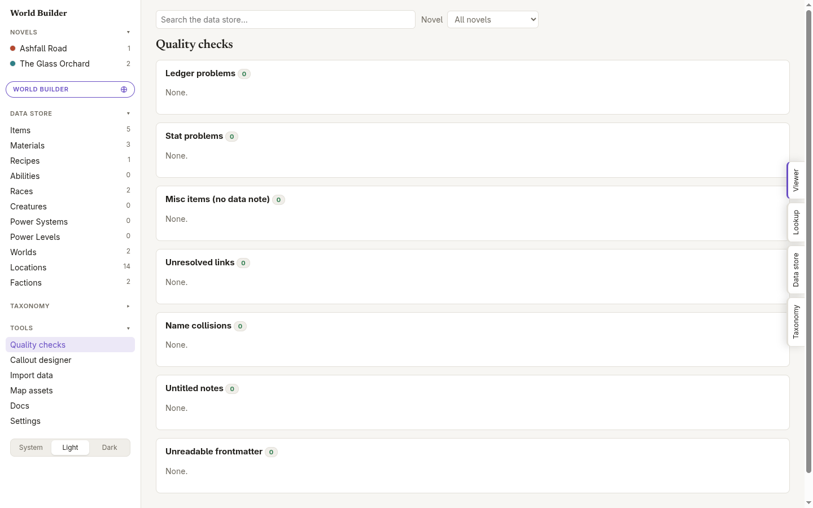

[Quality checks](app:#/qa) (sidebar → Tools) lists problems in the vault, each with a link to the note.

| Check | Means | Fix |
| --- | --- | --- |
| Ledger problems | An entry would leave stock below zero, or a line can't be read | Open the entry and correct the amounts |
| Stat problems | A value breaks its stat template (over the maximum, not a choice) | Fix the value, or the template |
| Misc items | Ledger lines naming an item that has no note | **Create entry & relink**: makes the data store note and relinks the lines |
| Unresolved links | Links to notes that don't exist | Create the note, or fix the link |
| Name collisions | Two notes with the same name, which Obsidian can't tell apart | Rename one (`Name (Label)`) |
| Untitled notes | Data store notes without a `title` | Add the title |
| Unreadable frontmatter | YAML that can't be parsed | Fix it in Obsidian |
