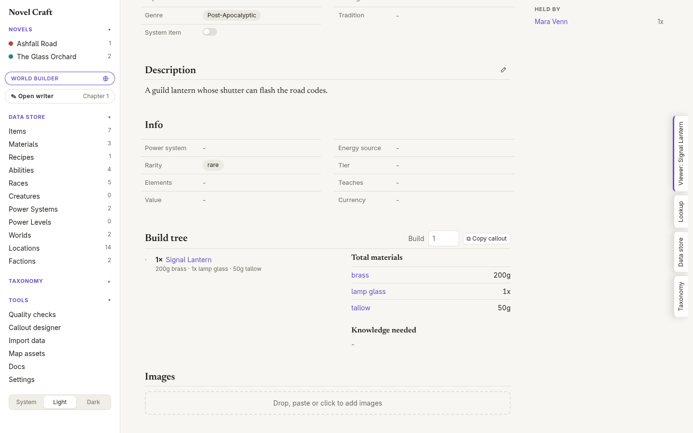

A recipe (blueprint) says what an item is made of: other items (components) and materials with amounts. Components can have blueprints of their own, so a blueprint is a tree.

## Making a recipe

An item without a recipe has **Create recipe**. Fill in the description, category, tier and power system (taken from the item), the disciplines, the materials with amounts and units, the components, and an assembly text. **Browse** looks components and materials up in the drawer. Comparable recipes (same categories, power system, nearby tier) are listed beside the form with their totals.

The recipe is saved as `Recipes/<Item> (Blueprint).md`, and the item links to it.

## Build tree and bill of materials

The page of an item with a recipe, and of the recipe, has a **Build tree** section: every component down to raw materials, beside the total materials, the parts without a blueprint and the knowledge needed. **Build** sets the number of units, and **Copy callout** copies a blueprint callout for that count. An item without a recipe has no such section.

Materials and items show **Used in**: every blueprint that needs them.
