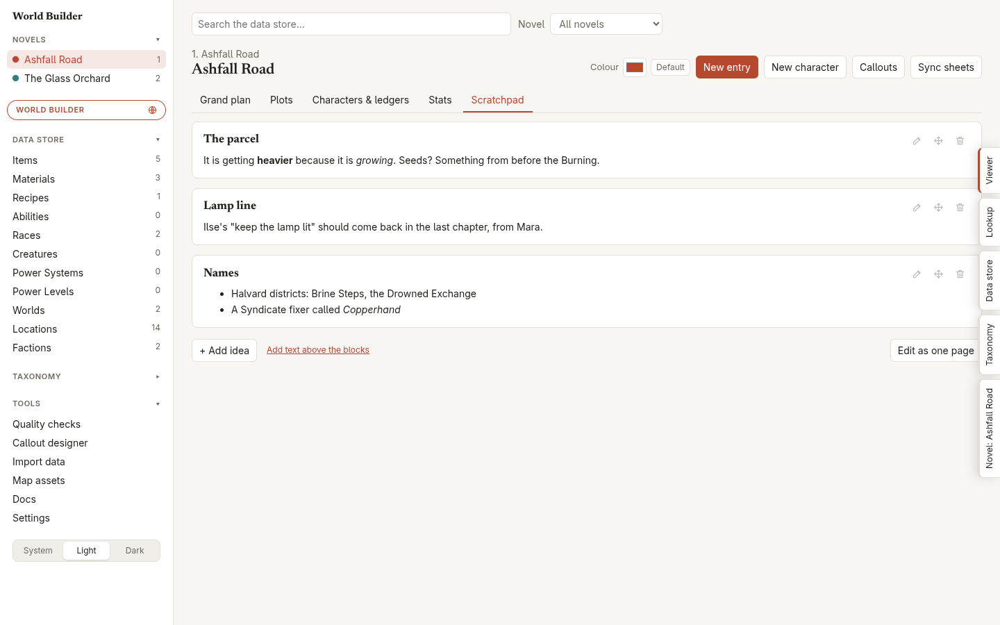

Each novel has a scratchpad for ideas that don't belong anywhere yet. Open it from the novel page's **Scratchpad** tab, or the side drawer's Novel tab.

## Ideas as blocks

- **+ Add idea** asks for a title, then opens the new block for writing.
- The pencil edits a block, the four arrows move it (then <kbd>↑</kbd> <kbd>↓</kbd>, and <kbd>Enter</kbd> or <kbd>Escape</kbd> to finish), the bin deletes it after a second click.
- Formatting works as in the [writer](docs:writing-a-chapter); callouts are left out.

**Edit as one page** opens the whole scratchpad in one editor, for writing freely.

The scratchpad is an ordinary note, `Plan/Scratchpad (<Novel>).md`, made the first time you press **Start the scratchpad**. Each idea is a `## Title` section, so it reads fine in Obsidian too.
