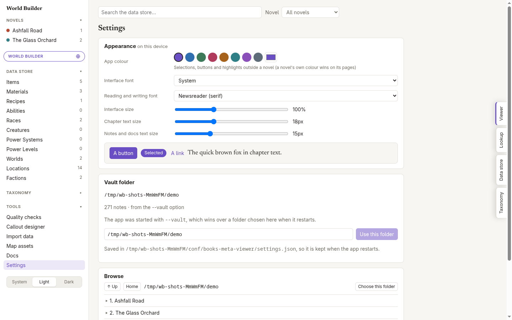

[Settings](app:#/settings) holds two things: how the app looks on this device, and which vault it opens.

## Appearance

| Setting | Changes |
| --- | --- |
| App colour | Buttons, selections and highlights wherever no novel colours the page. A novel's own colour (set on its page) wins inside it. |
| Interface font | Menus, tables, forms |
| Reading and writing font | Chapter text in the writer, notes, docs |
| Interface size | Zooms the whole app, 80–140%, with the − and + buttons |
| Notes and docs text size | Note bodies and these docs |

Changes show at once and are saved for this device. **Default** puts a setting back. The light / dark switch is at the bottom of the sidebar (System follows your computer).

## Chapter text

How the [writer](docs:writing-a-chapter) and its preview show a chapter. A sample paragraph below the settings shows each change.

| Setting | Changes |
| --- | --- |
| Text size | The size of chapter text, 13–28px |
| Paragraph spacing | The gap between paragraphs, 0–2.5 em (0.55 by default) |
| Column width | The widest the text column gets, 480–1600px (760px by default). It never gets wider than the writer, so with the side drawer open beside it the column fits the space that is left. |
| Speech colour | Dialogue in quotes in its own colour. Curly quotes (“ ” ‘ ’) count the same as straight ones |
| In 'single' quotes | An own colour for speech in single quotes, e.g. thoughts (otherwise the same as double quotes) |
| All in italics / bold / bold italics | An own colour for speech that is wholly in that style, every word of it. One stressed word in a line keeps the speech colour |
| Your own groupings | Text between marks you choose, such as `[System notice]` or `<<thought>>`, in its own colour (up to 8) |

### Which quotes count as speech

- Straight quotes (`"…"`, `'…'`) and curly ones (`“…”`, `‘…’`).
- Only the outermost quote: `"She said 'no' twice."` is one piece of speech.
- An opening quote has no letter or digit just before it, and no space after it. A closing quote has no letter or digit after it. So the apostrophes in *don't*, *'tis* and *the dogs' leads* are left alone.
- Speech in double quotes that isn't closed runs to the end of the paragraph, the way dialogue carries on into the next paragraph. Single quotes need their closing quote.
- Your own groupings follow the same rules and need their closing mark. `[[links]]`, `[text](links)` and `[field:: value]` are never a grouping, and a grouping inside speech (or speech inside a grouping) takes the outer one's colour.

### Light and dark

You pick one colour per style; the other theme gets the same colour with its brightness mirrored, so it stands out from the dark page as much as from the light one. A darker colour is taken as the light theme's, a lighter one as the dark theme's. The two **Aa** swatches beside each picker show both.

> [!note] Speech is coloured in the writer (also in the paragraph you're editing) and in its preview, not in callouts and quotes, and not in Obsidian.

## Vault folder

See [Choosing a vault](docs:choosing-a-vault).
