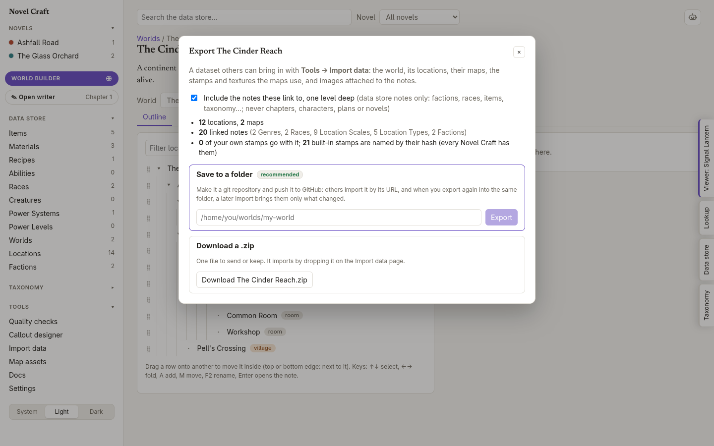

A world export holds everything needed to rebuild the world in another vault: the world note, all its locations, their maps, the stamps and textures those maps use, and the images attached to the notes.

## Exporting

1. Open the world in the [World builder](app:#/world) and press **Export world**.
2. Tick **Include the notes these link to** to bring the factions, races, items and taxonomy values the world and its places link to, one level deep. Only data store notes are taken, never chapters, characters, plans or novels.
3. Choose how to share it:
   - **Save to a folder** (recommended): give a folder outside the vault. Make it a git repository and push it to GitHub; others import it by its URL. Exporting again into the same folder replaces the previous export and keeps your `.git` and README.
   - **Download a .zip**: one file to send or keep.

Built-in stamps are not copied: every Novel Craft has them, so the export names them by their content hash. Your own stamps and derived textures go with the world.

## Importing

Open [Import data](app:#/import) and paste the repository's URL, or drop the `.zip` on the page. The [Importing data](docs:importing-data) guide covers the comparison steps. For worlds there is one more section, **Maps, stamps and textures**:

- Stamps you already have, matched by content, are used from your library and not copied again.
- Stamps only the maps carry (their files weren't included) can be added to your library, in `Map Stamps/Imported`.
- A derived texture whose name you already use for a different look can come in under a new name (the maps follow), replace yours, or make the maps use yours.

A world imported from git and later from a zip of the same world counts as the same dataset, so updates come in as updates. See [Import data reference](ref:import-reference) for every status.
