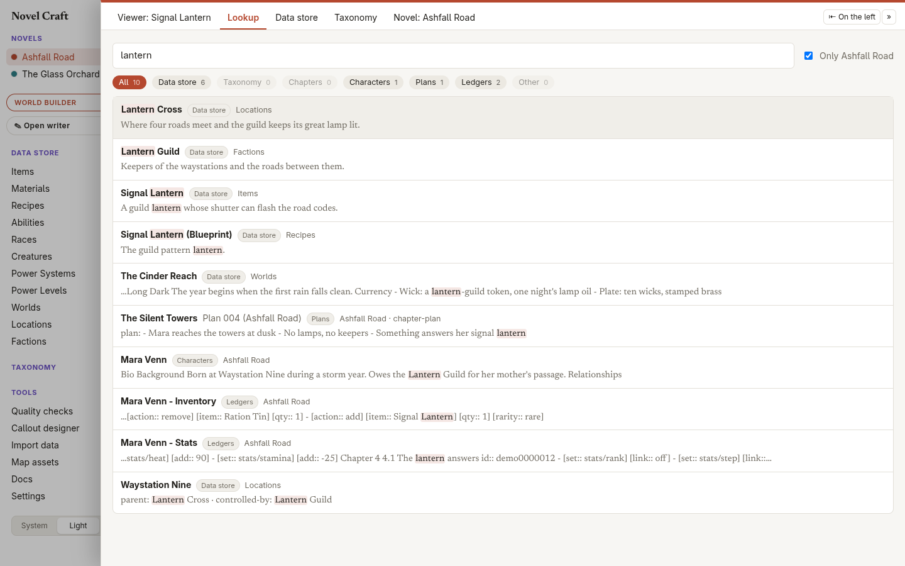
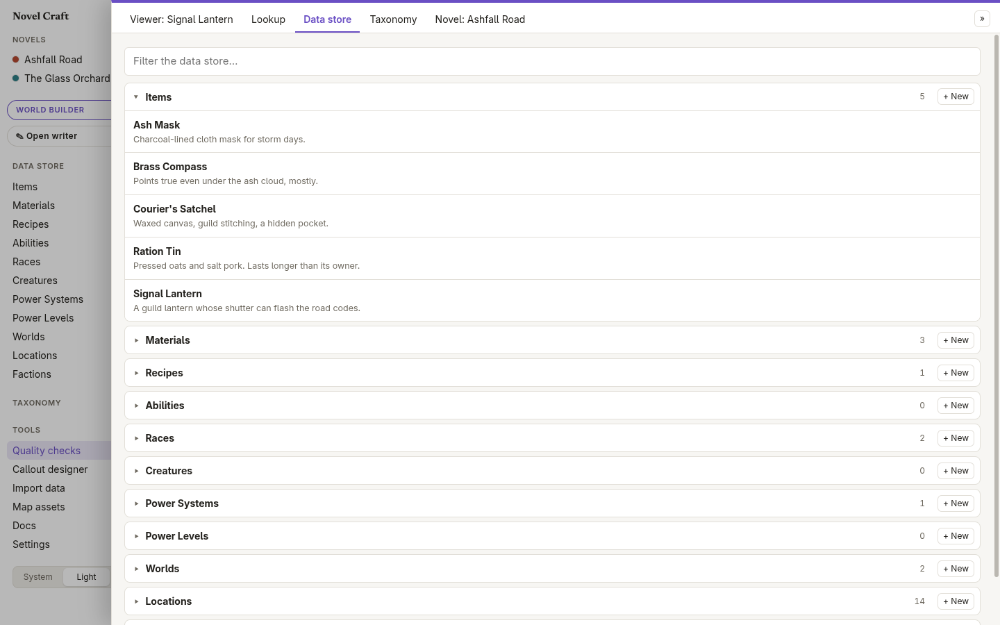

The drawer slides in from the right. Closed, it leaves a button per tab on the right edge.

| Tab | Holds |
| --- | --- |
| Viewer | The note, chapter or docs page you opened; the five most recent as boxes on top |
| Lookup | Search across everything: notes, taxonomy, chapter text |
| Data store | Every data store note, one group per collection |
| Taxonomy | Every taxonomy value, one group per facet |
| Novel | The novel you're in: plan, plots, characters, world, scratchpad |

<kbd>Ctrl</kbd>+<kbd>]</kbd> opens and closes it; <kbd>Escape</kbd> or a click beside it closes it. Closing never loses unsaved edits.

Beside the [writer](docs:writing-a-chapter) the two share the window half and half; <kbd>Ctrl</kbd>+<kbd>Shift</kbd>+<kbd>[</kbd> / <kbd>]</kbd> move the split and <kbd>Ctrl</kbd>+<kbd>Shift</kbd>+<kbd>\\</kbd> resets it.

## Lookup

Type to search names, fields and the text of chapters. Results are grouped by kind with counts; **Only <novel>** limits notes inside novel folders to the one you're in. Opening a result shows it in the Viewer and keeps it under **Recently opened**. Chapter results have **✎ Write**.

## Data store and Taxonomy

For when you don't know the name: each collection is a heading, only one open at a time. The filter hides what doesn't match and opens the first group with matches. **+ New** makes a note in that collection.

## Novel

The novel's grand plan, plots, characters (with **+ New character**), its world as an outline, and its scratchpad, without leaving the page you're on.
