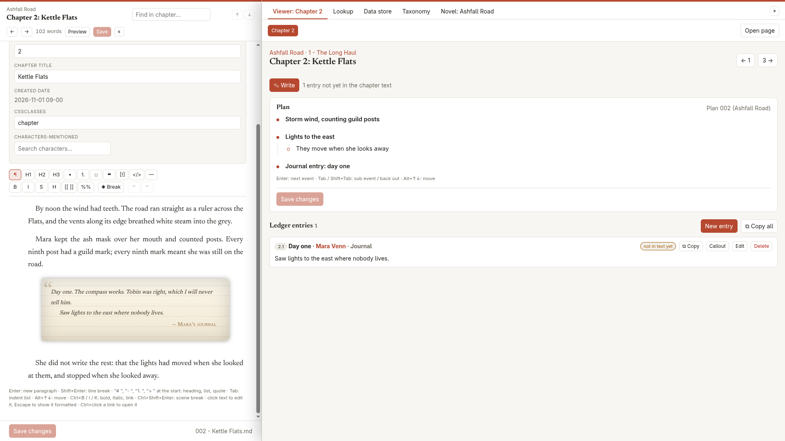
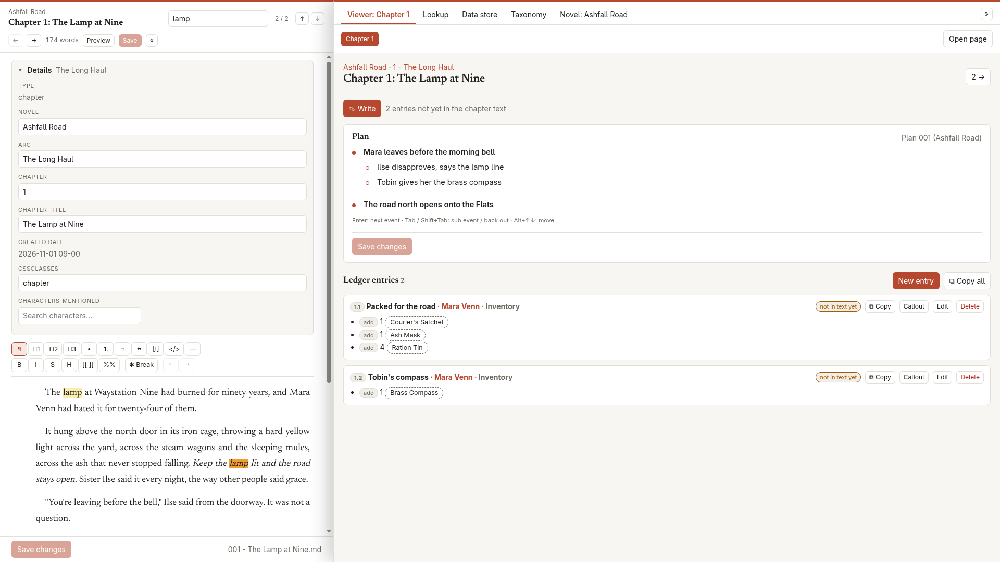

The writer opens a chapter note on the left of the window while the chapter's plan and ledger entries stay on the right, in the side drawer.

## Opening the writer

1. Open a chapter: on a novel's [Grand plan](docs:planning), click a chapter row.
2. Press **✎ Write**. A chapter without a note offers **Create chapter**, which names the file the way the Templater Chapter template does.
3. Close or reopen the writer any time with <kbd>Ctrl</kbd>+<kbd>[</kbd>, and the right drawer with <kbd>Ctrl</kbd>+<kbd>]</kbd>.

The right drawer keeps its width; the writer takes the rest of the window, with the text in a readable column.

## Fields on top

**Details** above the text holds the chapter note's frontmatter (title, arc, characters mentioned…), one field per row. Fold it away while writing.

## Writing in blocks

Each paragraph, heading, list item and callout is a block. Blocks show formatted until you click one; then that block shows its markdown and the cursor lands where you clicked. <kbd>Escape</kbd> shows it formatted again.

- <kbd>Enter</kbd> starts a new paragraph, <kbd>Shift</kbd>+<kbd>Enter</kbd> breaks the line inside it.
- Typing `# `, `- `, `1. `, `> ` or `- [ ] ` at the start of a paragraph turns it into a heading, list item, quote or task.
- <kbd>Backspace</kbd> at the start turns a heading or list item back into a paragraph, or joins the paragraph above.
- <kbd>Alt</kbd>+<kbd>↑</kbd> / <kbd>↓</kbd> moves a block.
- <kbd>Ctrl</kbd>+<kbd>B</kbd>, <kbd>I</kbd>, <kbd>K</kbd> toggle bold, italic and a `[[link]]`; with no selection they take the word at the cursor.

Paragraphs are justified with an indented first line, like the vault's chapter style. The size and font are on the [Settings](docs:settings-and-appearance) page. Every shortcut is in [Keyboard shortcuts](ref:keyboard-shortcuts).

## Scene breaks, callouts and images

Press **✱ Break** or <kbd>Ctrl</kbd>+<kbd>Shift</kbd>+<kbd>Enter</kbd> to insert a centred scene break: an image named `pb-…` from your vault, on a paragraph of its own. The novel's most used one comes first; set a default with `scene-break` in the novel's `config.md`.

Callouts and image lines show rendered, styled the way the [callout designer](docs:designing-callouts) says. Click one to edit its text.

## Find in the chapter

The find box in the writer's header highlights every match; <kbd>Enter</kbd> and <kbd>Shift</kbd>+<kbd>Enter</kbd> (or the arrows) step through them. <kbd>Ctrl</kbd>+<kbd>F</kbd> inside the writer jumps to it.

## Saving

**Save** (or <kbd>Ctrl</kbd>+<kbd>S</kbd>) writes only what changed: untouched paragraphs keep their exact text, and the frontmatter is only rewritten when you changed a field. **Preview** (<kbd>Ctrl</kbd>+<kbd>E</kbd>) shows the chapter as it reads.

> [!warning] If the chapter changed in Obsidian since you opened it, saving stops and offers to load the saved version. Copy anything you want to keep first.
